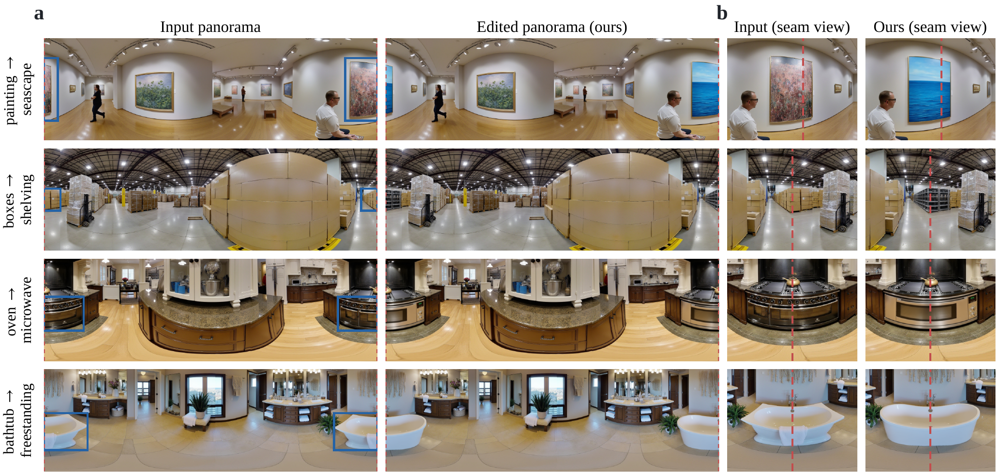
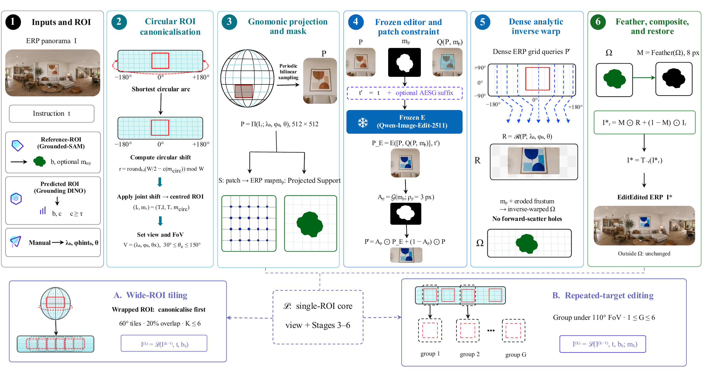

<div align="center">

# EditPano

### Edit one object in a 360° panorama without touching the rest of the scene, even when it straddles the seam.

Training-free, geometry-consistent local editing of equirectangular (ERP) panoramas
around **any frozen image editor**.

[](pyproject.toml)
[](LICENSE)
[](.github/workflows/ci.yml)
[](pyproject.toml)
[](src/editpano/py.typed)

[**How it works**](#how-it-works) · [**Results**](#results) · [**Quick start**](#quick-start) · [**Bring your own editor**](#bring-your-own-editor) · [**Reproduce**](docs/reproducibility.md) · [**中文简介**](#中文简介)

</div>

<p align="center">
  
</p>
<p align="center"><sub><b>Edits that cross the ERP border.</b> Left: input and EditPano output as stored ERP panoramas (the edited target is split across the left and right image borders). Right: the same seam re-centred for inspection (red line = stored ERP boundary). Each edit forms one coherent object across the seam and the surrounding scene stays put.</sub></p>

---

## Why EditPano?

Instruction-guided image editors such as Qwen-Image-Edit are trained on ordinary perspective photos.
Give them a whole 360° ERP panorama and two things go wrong:

* **They repaint everything.** One forward pass re-synthesises the entire canvas, so an edit to a
  lamp also changes the walls, the floor and the far side of the room: background PSNR drops to about 20 dB.
* **They meet a distorted canvas.** ERP stretches content with latitude, and the ±180° seam cuts
  objects into two unrelated halves at the left and right image borders.

EditPano leaves the editor as it is and handles the geometry around it:

> **localise → gnomonic projection → frozen edit → dense analytic inverse → inward-feathered composite**

The editor sees an undistorted, target-centred perspective patch it already handles well. Only
the edited support is written back to the sphere, and every other pixel is copied bit-exactly.

## Highlights

* 🎯 **Near-lossless background:** background PSNR rises from **19.5 dB to 78.5 dB** on the 31-scene benchmark, with the same target coverage.
* 🌐 **Seam-safe by construction:** circular canonicalisation makes the result *exactly* independent of where the ERP seam falls (Cross-YE-LPIPS **0.000** in 31/31 scenes).
* 🕳️ **Hole-free reprojection:** the dense analytic inverse reaches 37.3 dB round-trip PSNR with 0 % holes; forward scatter reaches 27.0 dB and leaves 48.8 % of pixels empty.
* 🔌 **Editor-agnostic:** works with Qwen-Image-Edit-2511 or SD-Inpaint through a two-method `PatchEditor` protocol, and new editors can be added as plugins.
* 🧩 **Wide and repeated targets:** narrow-FoV tiling for targets up to 360° wide, and grouped multi-instance editing for "replace *all* the chairs".
* 🔍 **End-to-end:** a frozen Grounding DINO detector can replace reference boxes.
* 🧪 **Tested:** the geometric core is pure NumPy/OpenCV and is covered by 86 CPU tests, including property tests for exact equivariance and bit-exact golden tests against the implementation evaluated in the thesis.

## How it works

<p align="center">
  
</p>

| Stage | What happens | Code |
| --- | --- | --- |
| ① Localise | reference box, frozen Grounding DINO, or a manual view hint; a confidence gate falls back to whole-ERP editing | [`localization`](src/editpano/localization) · [`pipeline/editpano.py`](src/editpano/pipeline/editpano.py) |
| ② Canonicalise | a target that wraps the seam becomes the shortest arc on S¹; an integer roll `T_r` centres it | [`geometry/circular.py`](src/editpano/geometry/circular.py) |
| ③ Project | adaptive view `θ = clip(1.5·max(Δλ·cos φ, Δφ), 30°, 150°)` gives a 512² gnomonic patch `P` and its sample map | [`geometry/projection.py`](src/editpano/geometry/projection.py) |
| ④ Edit | frozen editor on `[P, Q(P, m_p)]` (cyan-marked support); output constrained to the soft patch mask | [`editors`](src/editpano/editors) · [`pipeline/local.py`](src/editpano/pipeline/local.py) |
| ⑤ Reproject | dense analytic inverse `R = 𝓡(P̂)` evaluated on the ERP grid | [`geometry/projection.py`](src/editpano/geometry/projection.py) |
| ⑥ Composite | `I* = M ⊙ R + (1 − M) ⊙ I` with an inward chamfer-DT smoothstep ramp, then `T_{−r}` | [`geometry/compositing.py`](src/editpano/geometry/compositing.py) |

Because ② only shifts the longitude origin by whole pixels, the full operator
`F_can = T₋ᵣ ∘ 𝓛 ∘ Tᵣ` satisfies `F_can(T_q I, T_q m) = T_q F_can(I, m)` exactly for every integer shift
`q` (given a deterministic editor). This is a property of the construction, not something the editor learns,
and the test suite checks it bit-for-bit.

## Results

Frozen Qwen-Image-Edit-2511 with seed 0, evaluated on 31 test scenes with reference ROIs.
Paired sign-flip permutation tests are run per scene. Full protocols are in [docs/reproducibility.md](docs/reproducibility.md).

**Local editing vs. editing the whole panorama**

| Method | BG-PSNR (dB) ↑ | Coverage ↑ | Region-CLIP ↑ |
| --- | --- | --- | --- |
| Whole-ERP edit | 19.51 | 0.722 | 20.80 |
| **EditPano** | **78.48** | 0.718 | 20.55 |

BG-PSNR improves by **+58.97 dB** (p = 5·10⁻⁵, d_z = 5.62). Coverage (p = 0.93) and Region-CLIP (p = 0.30)
are statistically unchanged, so the preservation gain does not come from editing less. The same pattern holds
on 291 scenes and for removal, addition, attribute and style edits.

**Seam-position equivariance** (93 inputs = 31 scenes × {centre, near-seam, cross-seam})

| Strategy | Cross-YE-LPIPS ↓ | Scene-min coverage ↑ | Editor calls |
| --- | --- | --- | --- |
| Linear box (seam-unaware) | 0.5508 | 0.013 | 93 |
| Split into two fragments | 0.4298 | 0.614 | 124 |
| Direct circular projection | 0.0713 | 0.669 | 93 |
| **Circular canonical (EditPano)** | **0.0000** | **0.679** | 93 |

Circular canonical wins against the linear box in 31/0/0 scenes (p = 10⁻⁵). Its outputs for the three seam
positions are pixel-identical after alignment, and this holds for a second editor (SD-1.5 inpainting), for
three seeds (8-scene subset), and for the tiled extension.

**Reprojection** (editor-free patch → ERP → patch cycle)

| Operator | Cycle PSNR ↑ | Holes ↓ |
| --- | --- | --- |
| Forward scatter | 26.97 dB | 48.8 % |
| **Dense analytic inverse** | **37.28 dB** | **0 %** |

## Quick start

```bash
git clone https://github.com/ly-fish/panorama_editing.git && cd panorama_editing
pip install -e ".[edit]"                  # + ,grounding ,eval ,generation as needed
editpano doctor                           # dependencies, CUDA, cached weights
```

For bit-exact reproduction of the thesis numbers, install with the recorded versions:
`pip install -c requirements/thesis-env.txt ...` (see [docs/reproducibility.md](docs/reproducibility.md#environment)).
Qwen-Image-Edit-2511 runs in bf16 and needs a large-memory GPU (the thesis runs used an 80 GB H100,
about 1.5–2.5 min per edit). Everything else, and all tests, run on a CPU.

**Command line**

```bash
# Edit a target given as an ERP box (x2 > width wraps across the seam)
editpano edit --input room.jpg --prompt "Replace the sofa with a leather armchair" \
              --box 812 530 1104 690 --output room_edit.png --save-intermediates

# End to end: find the target with frozen Grounding DINO and edit every instance
editpano edit --input shop.jpg --prompt "Replace the sunflowers with red roses" \
              --detect "sunflower" --multi-instance --output shop_edit.png

# Try the pipeline without a GPU (deterministic fake editor)
editpano edit --input room.jpg --prompt "-" --box 812 530 1104 690 \
              --editor fake:pattern --output dry_run.png

# Text -> 360° panorama with DiT360 (FLUX.1-dev + LoRA; needs `[generation]`)
editpano generate --prompt "A cozy reading corner with wooden bookshelves" --output pano.png
```

**Python**

```python
from editpano import EditPano, EditPanoConfig

pano = EditPano()                                         # Qwen-Image-Edit-2511, thesis settings
result = pano.edit("room.jpg", "Replace the sofa with a leather armchair",
                   box=[812, 530, 1104, 690])
result.image.save("room_edit.png")
print(result.branch, result.editor_calls, result.meta["view"])   # 'local', 1, {'lat': ..., 'fov': ...}

# Wide targets: narrow-FoV tiles; any setting can be overridden with dotted keys
tiled = EditPano(EditPanoConfig().with_overrides({"tiling.mode": "auto"}))
```

`EditPano.edit` also accepts `mask=` (possibly seam-wrapping), `instances=[...]`, `hint=ViewHint(lon, lat)`
and `target="phrase"`. It returns an `EditResult` containing the panorama, every edited patch with its view,
and JSON provenance (config fingerprint, editor snapshot revision and timings).

## Bring your own editor

Any frozen perspective editor that maps *(patch, prompt, mask, seed) → patch* can be plugged in:

```python
from editpano import EditPano, EditorInfo, register_editor

@register_editor("my-editor")
class MyEditor:
    info = EditorInfo("my-editor", model_id="org/model")

    def edit(self, request):          # request.image / .prompt / .mask / .seed
        return run_my_model(request.image, request.prompt, request.mask, request.seed)

pano = EditPano(editor="my-editor")   # or expose it via the `editpano.editors` entry point
```

## Reproduce the thesis experiments

`editpano bench` runs the reference-ROI benchmark with nine comparison arms (whole-ERP, ERP-crop,
whole+paste, EditPano, tiled, detected ROI, multi-instance, cubemap, SD-Inpaint). Runs are
signature-cached and can be sharded across a SLURM array. `editpano seam` builds the longitude-origin stress
benchmark, gates it with a QA check, runs the five strategies and reports YE-LPIPS with paired statistics and
non-inferiority guardrails.

```bash
editpano bench run  --data-root data/test --prompts prompts.json --out-dir runs/ref \
                    --arms whole_erp editpano cubemap
editpano bench score  ... --region-clip && editpano bench report ...
editpano seam build ... && editpano seam validate ... && editpano seam run ... && editpano seam report ...
```

The refactored code was verified against the original research implementation. Replaying the cached thesis
patches reproduces all 31 benchmark panoramas and all 93 seam-study outputs **bit-for-bit**, and recomputed
metrics match the thesis. See [docs/reproducibility.md](docs/reproducibility.md). Datasets and model outputs
are not distributed; the expected layout is in [docs/data_format.md](docs/data_format.md).

## Project layout

```
src/editpano/
├── geometry/        # pure NumPy/OpenCV: camera, projection, compositing, circular ROI, tiling
├── editors/         # PatchEditor port + qwen / sd_inpaint / fake adapters, plugin registry
├── localization/    # reference ROIs (Grounded-SAM annotations), frozen Grounding DINO
├── pipeline/        # LocalEditOperator, seam strategies, multi-instance, EditPano facade
├── generation/      # DiT360 text-to-panorama (FluxPipeline subclass)
├── evaluation/      # metrics, paired statistics, benchmark arms/runner, seam study
├── config.py        # frozen, validated, hashable configuration
└── cli.py           # `editpano` command
configs/             # YAML operating points (default, SD-Inpaint, tiled)
requirements/        # exact environment used for the thesis results
scripts/slurm/       # array-job templates for the benchmark and the seam study
docs/                # architecture, data format, reproducibility, figures
tests/               # unit, integration and golden tests (CPU, no weights)
```

The layering, invariants and extension points are described in [docs/architecture.md](docs/architecture.md).

## Development

```bash
pip install -e ".[dev]"
make check          # ruff lint + format check, mypy, pytest
```

## Limitations

EditPano is designed for spatially bounded edits in a single still panorama, such as replacing, removing,
adding or restyling an object. It is not meant for scene-wide lighting, weather or layout changes. Edit
quality depends on the frozen editor and on localisation (detector misses reduce coverage). Very wide targets
need several tiles, which costs more editor calls and can vary in appearance between tiles. The exact
equivariance guarantee covers integer longitude shifts of rectangular supports under deterministic execution,
not arbitrary masks or spherical rotations.

## Citation

```bibtex
@phdthesis{yu2026generative,
  author = {Yu, Liangyue},
  title  = {Generative {AI} and Multi-Agent Systems for Adaptive Interaction in Immersive Environments},
  school = {University of Glasgow},
  year   = {2026},
  note   = {Chapter 3: EditPano, geometry-consistent panoramic generation and editing}
}
```

## License

[Apache-2.0](LICENSE). The model weights used by the adapters (Qwen-Image-Edit, Stable Diffusion, Grounding
DINO, FLUX.1-dev, DiT360) are distributed separately under their own licenses.

---

## 中文简介

**EditPano** 是一个面向 360° 等距柱状投影（ERP）全景图的**免训练、几何一致的局部编辑框架**。它不修改、也不微调编辑模型，只处理编辑器外围的几何：

1. **定位**：使用参考框、冻结的 Grounding DINO 或手动视角；置信度不足时回退为整图编辑；
2. **圆周规范化**：把跨越 ±180° 接缝的目标表示为 S¹ 上的最短弧，用整数平移把它移到画面中央；
3. **Gnomonic 投影**：按目标自适应选择视场角，得到无畸变的 512² 透视 patch；
4. **冻结编辑**：用 Qwen-Image-Edit-2511 或 SD-Inpaint 编辑 patch，并用软掩码约束输出；
5. **解析逆映射回投**：在整张 ERP 网格上稠密求逆，按构造无空洞；
6. **向内羽化合成**：羽化过渡全部位于编辑区域内部，区域外像素与原图逐位一致。

在 31 个测试场景上，背景 PSNR 从 **19.51 dB 提升到 78.48 dB**，目标覆盖率与 Region-CLIP 无显著差异。圆周规范化使编辑结果与接缝位置**严格无关**（31/31 个场景 Cross-YE-LPIPS = 0）。

本仓库是原研究代码的工程化重构，主要内容：

* 纯 NumPy/OpenCV 的几何核心；
* 基于端口/适配器的编辑器插件体系；
* 类型化、可哈希的配置；
* 可缓存、可分片的评测框架；
* 完整的 CLI；
* 86 个 CPU 测试（包括与论文实现逐位一致的 golden 测试）。

仓库不包含数据集和模型输出，数据格式见 [docs/data_format.md](docs/data_format.md)，实验复现见 [docs/reproducibility.md](docs/reproducibility.md)。
